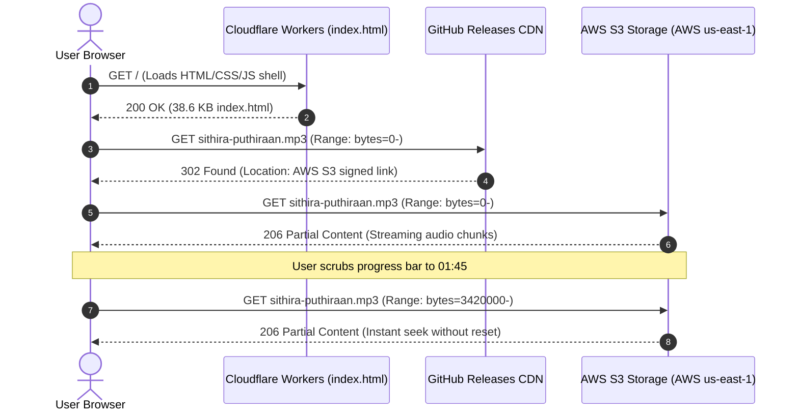

# Sithira Puthiri & ISAI — Interactive Web Audio & Synchronized Lyrics Experience

[](https://sithira-puthiri.naishalpnadiya988.workers.dev/)
[](https://naishal988.naishalpnadiya988.workers.dev/)
[-181717?style=for-the-badge&logo=github&logoColor=white)](https://github.com/naishal988/Isai-assests)
[](LICENSE)

> A high-performance, edge-rendered Web Audio experience with Apple Music-inspired liquid glass aesthetics, real-time LRC lyrics synchronization, and resilient HTTP 206 byte-range media streaming. Engineered by **Naishal Nadiya (naishal988)**.

---

## 1. Executive Summary & Vision

### Origins: Sithira Puthiri Player
The project was originally engineered as a dedicated, high-fidelity web audio player for the viral hit **"Sithira Puthiri"** composed by **Sai Abhyankkar** (released under *Think Indie*). Deployed directly on **Cloudflare Workers** at:
```
https://sithira-puthiri.naishalpnadiya988.workers.dev/
```
The application was designed to solve common limitations of web music playback on edge platforms—specifically eliminating seek resets, optimizing mobile typography, and creating a native desktop and mobile lock-screen media experience.

### Evolution: Project "ISAI" (42-Track Discography Hub)
The application architecture serves as the foundation for **ISAI**, an expansive interactive showcase spanning composer Sai Abhyankkar's complete catalog of **42 curated tracks**:

* **Independent Singles (8 Tracks):** Breakthrough viral hits including *Katchi Sera*, *Aasa Kooda*, *Sithira Puthiri*, and special collaborative singles.
* **Tamil Feature Films (21 Tracks):** Original motion picture soundtracks, themes, and high-energy background scores.
* **Telugu Feature Films (8 Tracks):** Multilingual regional releases, lyrical dubs, and cinematic tracks.
* **Malayalam Feature Films (5 Tracks):** Regional adaptations and cross-industry releases.

**Core ISAI Capabilities:**
* Categorical filtering by language and release type (*Independent*, *Tamil*, *Telugu*, *Malayalam*).
* Real-time metadata and album artwork switching.
* Synchronized karaoke-style scrolling lyrics (LRC) for supported tracks.
* Persistent edge deployment on Cloudflare Workers without moving or breaking the live canonical URL: `https://sithira-puthiri.naishalpnadiya988.workers.dev/`.

---

## 2. Codebase Architecture & File Structure

The project follows a zero-build, dependency-free philosophy using pure Vanilla HTML5, CSS3, and ES6+ JavaScript:

```
sithira-puthira/
├── .gitignore              # Ignores IDE configs (.vscode), OS artifacts, and *.mp3 binaries
├── README.md               # Complete architectural documentation & project guide
├── cover.jpg               # High-resolution album artwork (57.8 KB, WebP/JPG optimized)
├── index.html              # Single-file unified web app (DOM, Styles, Audio Engine, Lyrics Parser)
└── sithira-puthiraan.lrc   # Standard timestamped LRC file ([mm:ss.xx] format, 55 lines)
```

### File-by-File Breakdown

#### `index.html` (Unified Web Application Core)
* **Lines 1–56 (SEO & Linked Data):** Complete OpenGraph metadata, JSON-LD Schema (`WebApplication` and `Person`), canonical link, and responsive viewport parameters.
* **Lines 57–504 (Design System & CSS):** Apple Music dark-mode aesthetic with custom CSS variables (`--theme-pink: #ff416c`, `--theme-orange: #ff4b2b`, `--glass-bg`), animated SVG orbs, frosted glass player panel (`backdrop-filter: blur(28px)`), and liquid text animations.
* **Lines 505–596 (Semantic DOM Structure):** Two-column master grid (`.left-pane` for album art & transport card; `.right-pane` for scrollable synchronized lyrics).
* **Lines 597–1002 (ES6+ Web Audio Engine):**
  * Byte-range CDN streaming controller.
  * Dragging-state lock (`isDragging`) protecting user scrubbing from `timeupdate` overwrites.
  * Real-time LRC parser and sub-second timestamp matching engine.
  * Centered smooth-scrolling lyrics algorithm (`lyricsBox.scrollTo()`).
  * Keyboard navigation listener (`Space`, `ArrowLeft`, `ArrowRight`, `KeyM`).
  * Full W3C `navigator.mediaSession` integration.

#### `sithira-puthiraan.lrc` (Synchronized Lyrics Asset)
* Contains 55 timestamped cues indexed to 1/100th of a second:
  ```lrc
  [00:11.26]Sithira puthiri vandhaalum kannula kaththiri thandhaalum
  [00:15.58]Niththira koththida ninnaalum niththiram un mugam vandhaadum
  ...
  [03:39.72]Ennammo onnu pannaalae
  ```
* Parsed on client runtime with embedded fallback data to ensure instant render without network race conditions.

#### `cover.jpg`
* Master 1:1 square artwork used for the hero UI card, browser favicon, OpenGraph social cards, and mobile OS Media Session lock-screen artwork.

#### `.gitignore`
* Prevents repository bloat by strictly ignoring `.vscode/`, `.DS_Store`, and `*.mp3` binary audio files (since media assets are decoupled to the external CDN).

---

## 3. External Audio & Asset Pipeline (`naishal988/Isai-assests`)

### The Edge Challenge
Deploying large audio files (5 MB to 15 MB) directly inside a Cloudflare Workers Static Assets bundle introduces critical issues:
1. **Cloudflare Worker Static Asset Limits:** Standard free and pro tiers impose strict file size limits and bandwidth quotas on static asset bindings.
2. **Missing HTTP 206 Range Request Support:** When static files are served without proper `Accept-Ranges: bytes` headers or 206 Partial Content handling, scrubbing or seeking causes the browser's HTMLMediaElement to reset `currentTime` back to `0:00`.

### The Solution: Decoupled GitHub Releases CDN
All heavy binary audio assets are hosted in a dedicated public repository:
```
https://github.com/naishal988/Isai-assests/
```
Audio tracks are released as versioned binary release assets:
* **Primary Audio Asset URL:**
  ```
  https://github.com/naishal988/Isai-assests/releases/download/v1.0.0/sithira-puthiraan.mp3
  ```



### Critical CORS & Web Audio Implementation Rule
* **No `crossorigin="anonymous"` on `<audio>`:**
  GitHub Releases URLs return a `302 Found` redirect to Amazon S3. AWS S3 release asset signed URLs do not emit permissive cross-origin headers for raw media tags. Setting `crossorigin="anonymous"` triggers CORS preflight rejections. Standard HTML5 `<audio>` playback and native byte-range seeking execute cleanly without the attribute.
* **`preload="metadata"`:**
  Ensures duration and audio track structure are parsed upfront without prematurely buffering the entire 7.7 MB payload on cellular connections.

---

## 4. Audio Engine & Scrubbing State-Lock Architecture

### The "Seek Reset Bug" and its Fix
In naive implementations, listening to `<audio>`'s `timeupdate` event directly modifies the slider value:
```javascript
// NAIVE IMPLEMENTATION (BUGGY)
audio.addEventListener('timeupdate', () => {
    slider.value = audio.currentTime; // Overwrites user thumb while dragging!
});
```
When a user touches or drags the scrubber, `timeupdate` fires asynchronously from the decoder, snapping the thumb back to the previous playback position and resetting `audio.currentTime` to `0:00`.

### State-Lock Resolution
The application uses a **Dual-State Concurrency Lock**:

```javascript
let isDragging = false;     // True while user holds the scrub handle
let isAudioSeeking = false;  // True while browser negotiates network byte range
```

1. **Scrubbing Capture:**
   On `mousedown` or `touchstart`, `isDragging` is set to `true`. While `isDragging === true`, `timeupdate` events are completely ignored for UI updates, allowing the user to scrub smoothly.
2. **Clean Commit:**
   On `change`, `mouseup`, or `touchend`, `commitSeek(targetTime)` is invoked:
   ```javascript
   function commitSeek(targetTime) {
       if (isNaN(targetTime) || !isFinite(targetTime)) return;
       const duration = audio.duration || targetTime;
       const clamped = Math.max(0, Math.min(targetTime, duration));

       // Instant visual feedback
       const pct = (clamped / duration) * 100;
       seekerFill.style.width = `${pct}%`;
       slider.value = clamped;
       timeCurrent.innerText = formatTime(clamped);

       isAudioSeeking = true;
       playBtn.classList.add('is-buffering');

       // Modern fastSeek with reliable currentTime fallback
       if (typeof audio.fastSeek === 'function') {
           try {
               audio.fastSeek(clamped);
           } catch (e) {
               audio.currentTime = clamped;
           }
       } else {
           audio.currentTime = clamped;
       }

       updateMediaSessionPosition();
   }
   ```
3. **Buffering & Network State Management:**
   * `waiting` & `seeking` events add `.is-buffering` to `#play-btn`, displaying an animated SVG spinner ring.
   * `canplay`, `playing`, `pause`, and `seeked` events cleanly remove the buffering state.

---

## 5. Synchronized Lyrics Engine (LRC)

### Data Ingestion & Fallback Pipeline
The player implements a dual-layer lyrics ingestion system:
1. **Embedded Complete Lyrics Array:** 55 parsed lines hardcoded in JavaScript memory for instantaneous zero-latency first-frame paint.
2. **Live Dynamic Fetcher (`loadLiveLRC()`):** Asynchronously requests `sithira-puthiraan.lrc` to hot-reload lyrics if revisions are deployed to the server without restarting client sessions.

### Sub-Second Lyric Highlighting & Centering
On every `timeupdate` tick, binary search checks the active lyric index with a `-0.22s` psychoacoustic lead offset:
```javascript
let newIndex = -1;
for (let i = 0; i < lyricsArray.length; i++) {
    if (current >= lyricsArray[i].time - 0.22) {
        newIndex = i;
    } else {
        break;
    }
}
```

### Apple Music Liquid Typography
* **Active Line (`.lyric-line.active`):** Scale `1.08`, zero blur, 100% opacity, and an animated animated background gradient clipping:
  ```css
  background: linear-gradient(120deg, #ffffff 0%, var(--theme-pink) 50%, var(--theme-orange) 100%);
  -webkit-background-clip: text;
  background-clip: text;
  -webkit-text-fill-color: transparent;
  animation: liquidText 4.5s linear infinite;
  ```
* **Inactive Lines:** Scaled down (`0.92`), blurred (`2.5px`), and dimmed (`opacity: 0.16`) to create depth.
* **Click-to-Seek:** Clicking any lyric line immediately jumps the audio to that timestamp and starts playback if paused.
* **Precision Smooth-Scroll:** Calculated relative to the lyrics viewport center rather than `scrollIntoView()` to eliminate whole-window jump artifacts:
  ```javascript
  const offset = (lineRect.top - boxRect.top) + lyricsBox.scrollTop - (boxRect.height / 2) + (lineRect.height / 2);
  lyricsBox.scrollTo({ top: Math.max(0, offset), behavior: 'smooth' });
  ```

---

## 6. UI/UX Design System (Liquid Glass & Apple Music Theme)

| Design Element | Specification | Visual Purpose |
| :--- | :--- | :--- |
| **Color Palette** | Midnight Black (`#030305`), Deep Crimson (`#22080d`), Sunset Pink (`#ff416c`), Coral Orange (`#ff4b2b`) | Recreates the nocturnal energy of Sithira Puthiri |
| **Ambient Backdrop** | Dual radial orbs with CSS keyframe `breathe` (12s ease-in-out cycle) and 140px Gaussian blur | Subtle living glow that reacts behind frosted glass |
| **Glass Panel** | `rgba(35, 12, 18, 0.65)` with `backdrop-filter: blur(28px)` and specular border `rgba(255, 255, 255, 0.16)` | Frosted glass look inspired by Apple iOS/macOS |
| **Transport Cluster** | Clean 3-button layout: Previous (`|◄`), Circular Play (`►`), and Next (`►|`) | Eliminates visual clutter; focuses user on music |
| **Mobile Drawer** | Slide-up full-screen sheet (`transform: translateY(100%)` to `0` with cubic-bezier transition) | Fluid native iOS sheet behavior on screens ≤ 1024px |

---

## 7. Keyboard Shortcuts & Media Session API

### Global Keyboard Controls
| Key | Action | Technical Execution |
| :--- | :--- | :--- |
| <kbd>Space</kbd> | Play / Pause Toggle | `e.preventDefault()`, calls `togglePlay()` |
| <kbd>←</kbd> (Arrow Left) | Seek Backward 5s | Clamped to `Math.max(0, audio.currentTime - 5)` |
| <kbd>→</kbd> (Arrow Right) | Seek Forward 5s | Clamped to `Math.min(duration, audio.currentTime + 5)` |
| <kbd>M</kbd> | Mute / Unmute Toggle | Inverts `audio.muted` |

### W3C Media Session API (`navigator.mediaSession`)
Full lock-screen and peripheral hardware media control binding:
```javascript
navigator.mediaSession.metadata = new MediaMetadata({
    title: 'Sithira Puthiri',
    artist: 'Sai Abhyankkar',
    album: 'Sithira Puthiri (From "Think Indie")',
    artwork: [
        { src: 'cover.jpg', sizes: '96x96', type: 'image/jpeg' },
        { src: 'cover.jpg', sizes: '128x128', type: 'image/jpeg' },
        { src: 'cover.jpg', sizes: '192x192', type: 'image/jpeg' },
        { src: 'cover.jpg', sizes: '256x256', type: 'image/jpeg' },
        { src: 'cover.jpg', sizes: '384x384', type: 'image/jpeg' },
        { src: 'cover.jpg', sizes: '512x512', type: 'image/jpeg' }
    ]
});
```
* **Handlers Registered:** `play`, `pause`, `seekbackward` (5s), `seekforward` (5s), `seekto` (scrubbing from OS control center), `previoustrack`, and `nexttrack`.
* **Dynamic Position Reporting:** `navigator.mediaSession.setPositionState()` updates position and playback rate in real time.

---

## 8. Technical SEO, Metadata & Knowledge Graph Schema

The web app is indexed by search engines and social scrapers, attributing the engineering work to **Naishal Nadiya**:

### Canonical & Identity Links
* `canonical`: `https://sithira-puthiri.naishalpnadiya988.workers.dev/`
* `author`: `https://naishal988.naishalpnadiya988.workers.dev/`

### OpenGraph & Social Protocols
```html
<meta property="og:type" content="music.song">
<meta property="og:site_name" content="Sithira Puthiri UI">
<meta property="og:title" content="Sithira Puthiri — Apple Music UI by Naishal">
<meta property="og:description" content="Synchronized web audio player engineered by Naishal (naishal988).">
<meta property="og:url" content="https://sithira-puthiri.naishalpnadiya988.workers.dev/">
<meta property="og:image" content="cover.jpg">
```

### Google Knowledge Graph JSON-LD Structured Data
```json
{
  "@context": "https://schema.org",
  "@type": "WebApplication",
  "name": "Sithira Puthiri Interactive Player",
  "url": "https://sithira-puthiri.naishalpnadiya988.workers.dev/",
  "applicationCategory": "MultimediaApplication, MusicApplication",
  "operatingSystem": "Web",
  "description": "Interactive Web Audio player with synchronized LRC lyrics engineered by Naishal.",
  "author": {
    "@type": "Person",
    "name": "Naishal",
    "alternateName": ["Naishal Nadiya", "naishal988"],
    "jobTitle": "System Architect & Creative Developer",
    "url": "https://naishal988.naishalpnadiya988.workers.dev/",
    "sameAs": [
      "https://github.com/naishal988",
      "https://linkedin.com/in/naishal-nadiya/"
    ]
  }
}
```

---

## 9. Deployment to Cloudflare Workers

The application is deployed to Cloudflare's edge network via Cloudflare Workers Static Assets.

### Deployment Process
1. Changes to `index.html`, `cover.jpg`, and `sithira-puthiraan.lrc` are committed to GitHub:
   ```bash
   git add .
   git commit -m "feat: updates to player experience"
   git push origin main
   ```
2. Connected Cloudflare Workers CI/CD automatically detects commits on `main` and deploys static assets to 300+ edge locations worldwide.
3. Live URL remains permanently reachable at:
   ```
   https://sithira-puthiri.naishalpnadiya988.workers.dev/
   ```

---

## 10. Creator & Author Attribution

| Attribute | Detail |
| :--- | :--- |
| **Engineer & Architect** | **Naishal Nadiya (`naishal988`)** |
| **Professional Role** | System Architect & Cybersecurity Researcher |
| **Live Web Player** | [sithira-puthiri.naishalpnadiya988.workers.dev](https://sithira-puthiri.naishalpnadiya988.workers.dev/) |
| **Portfolio & Master Hub** | [naishal988.naishalpnadiya988.workers.dev](https://naishal988.naishalpnadiya988.workers.dev/) |
| **GitHub Profile** | [@naishal988](https://github.com/naishal988) |
| **LinkedIn Profile** | [linkedin.com/in/naishal-nadiya](https://www.linkedin.com/in/naishal-nadiya/) |
| **Audio Assets Repository** | [github.com/naishal988/Isai-assests](https://github.com/naishal988/Isai-assests) |

---

*Engineered with precision for web audio performance, fluid motion, and accessible lyrics synchronization.*
